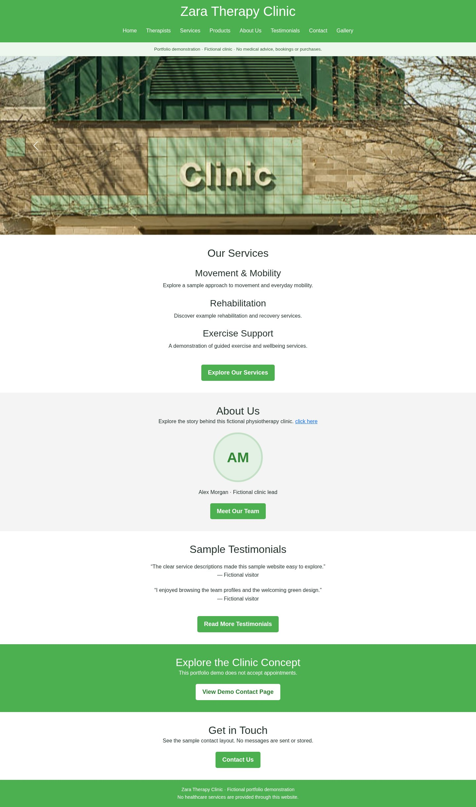
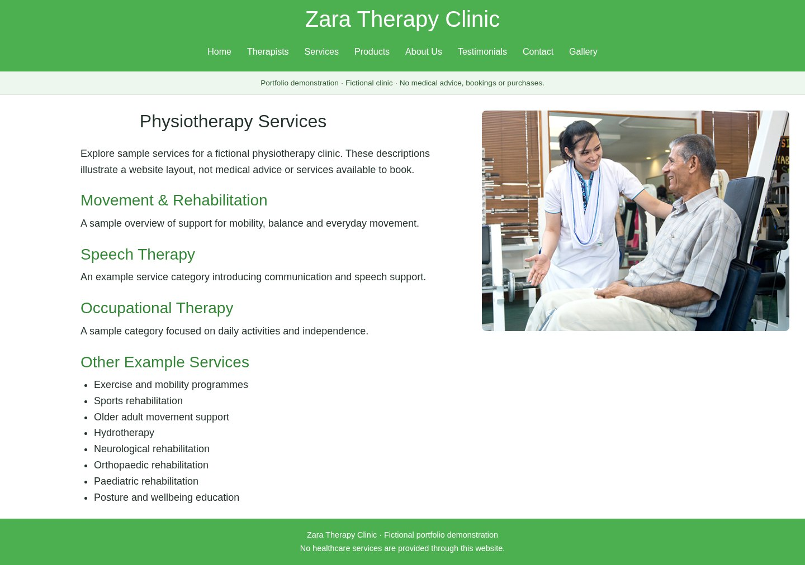
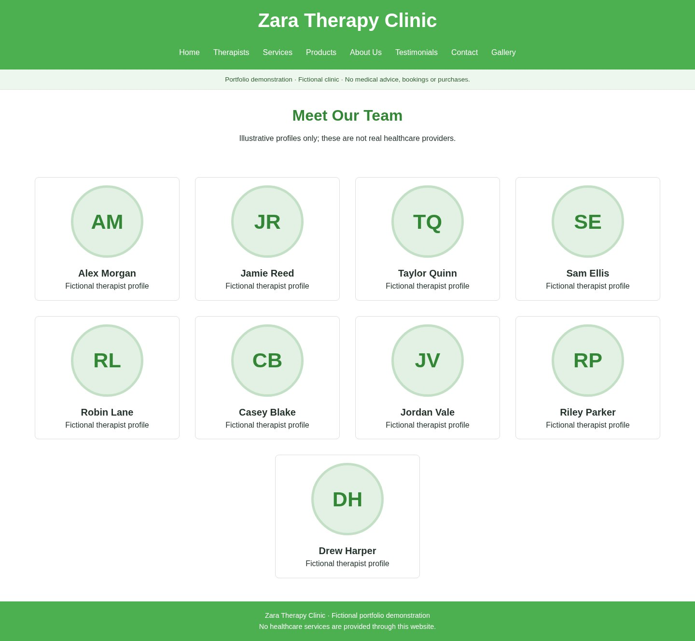
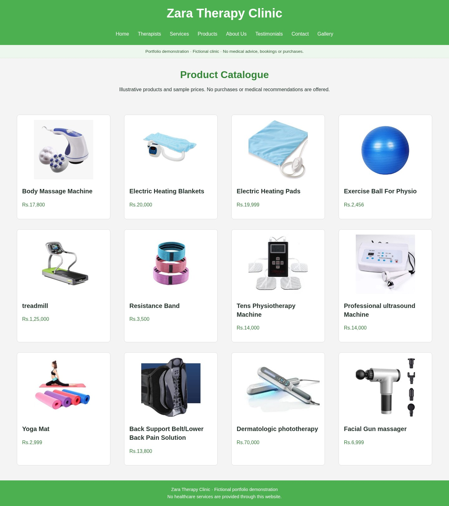
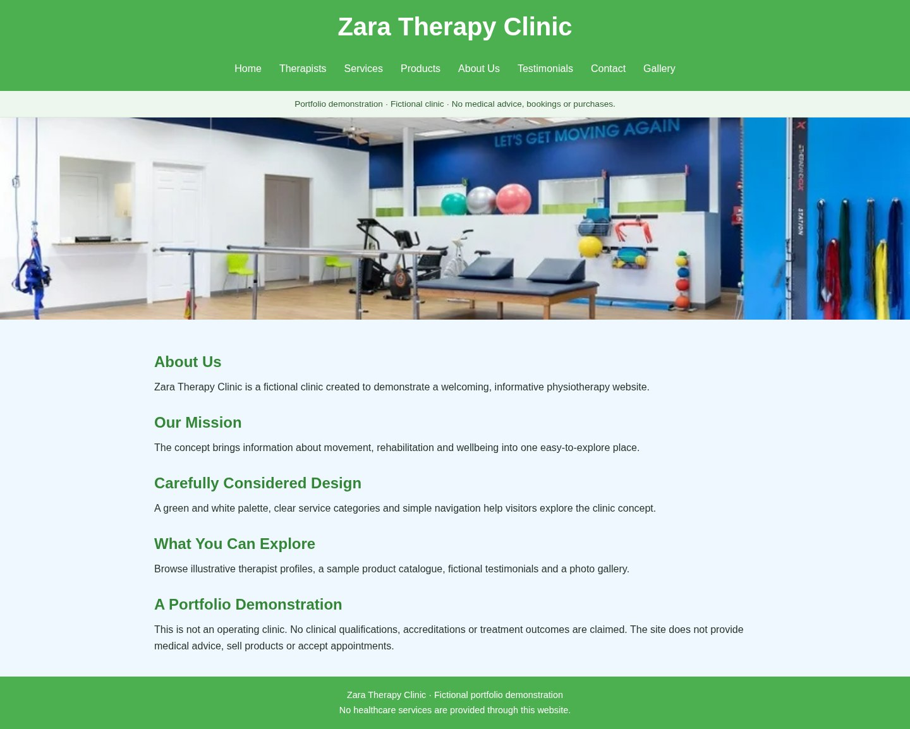
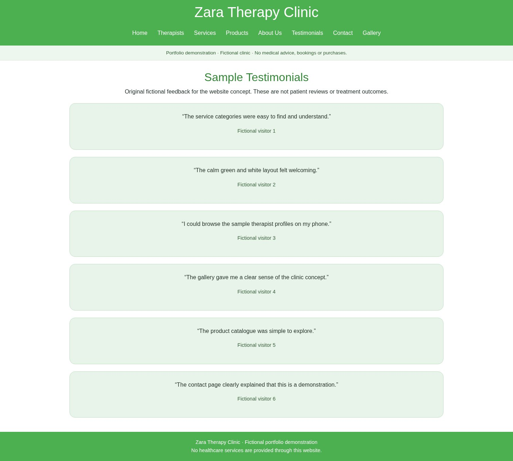
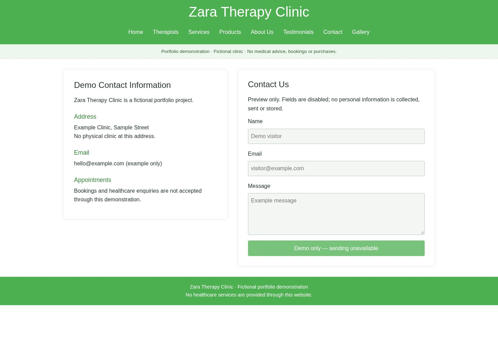
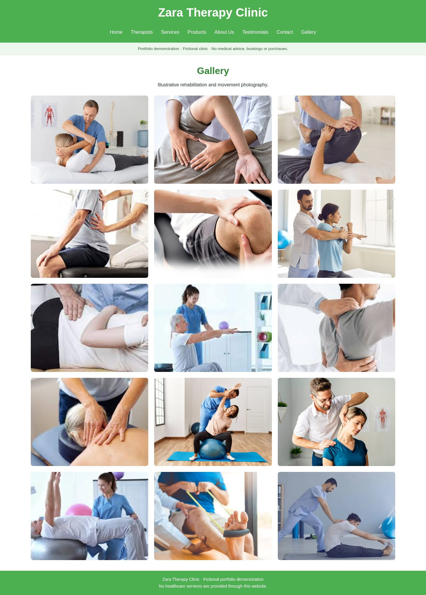
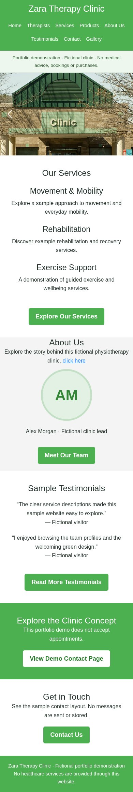
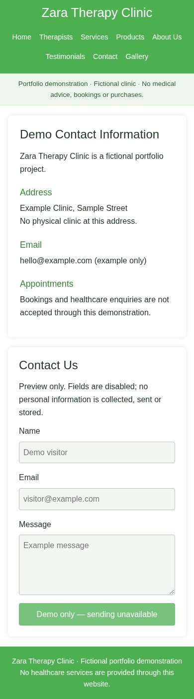

# Zara Therapy Clinic — Physiotherapy Website

A responsive, multi-page website concept for a fictional physiotherapy clinic. Built with HTML, CSS and Bootstrap, it brings services, therapist profiles and clinic information together in a welcoming green-and-white design.

This is a portfolio demonstration: no healthcare services, appointment bookings, purchases or message delivery are offered.

[](docs/screenshots/homepage.jpg)

## Key features

- Eight connected pages with consistent navigation
- Clinic homepage with an interactive image carousel
- Physiotherapy service descriptions and fictional therapist profiles
- Product catalogue with illustrative prices
- About page and clearly labelled fictional testimonials
- Sample contact information and a disabled contact-form preview
- Photo gallery with hover effects
- Responsive layouts for desktop and mobile

## Technology stack

- **HTML5** — page structure and semantic content
- **CSS3** — green-and-white styling, responsive layouts and gallery effects
- **Bootstrap 5.0.2** — carousel, cards and form styling
- **JavaScript** — Bootstrap's bundled carousel controls

Bootstrap is included locally, so the site requires no CDN connection or build step.

## Website screenshots

Real browser captures at a consistent 1440-pixel desktop width. Click any image to view it at full resolution.

<details>
<summary>Services and therapist profiles</summary>

### Services

[](docs/screenshots/services.jpg)

### Meet Our Team

[](docs/screenshots/team.jpg)

</details>

<details>
<summary>Products, about and testimonials</summary>

### Products

[](docs/screenshots/products.jpg)

### About Us

[](docs/screenshots/about.jpg)

### Testimonials

[](docs/screenshots/testimonials.jpg)

</details>

<details>
<summary>Contact and gallery</summary>

### Contact Us

[](docs/screenshots/contact.jpg)

### Gallery

[](docs/screenshots/gallery.jpg)

</details>

<details>
<summary>Mobile views</summary>

### Homepage

<a href="docs/screenshots/homepage-mobile.jpg"></a>

### Contact Us

<a href="docs/screenshots/contact-mobile.jpg"></a>

</details>

## Live demo

GitHub Pages deployment is prepared. A live link will be added after the public deployment has been verified.

## Run locally

```sh
git clone https://github.com/aymenmansoor/physiotherapy-website.git
cd physiotherapy-website
python3 -m http.server 8000
```

Open `http://localhost:8000` in your browser. Alternatively, open `index.html` directly; no package installation is required.

## Project structure

```text
├── index.html              # Homepage
├── Services.html           # Physiotherapy services
├── meetourteam.html        # Fictional therapist profiles
├── products.html           # Sample product catalogue
├── aboutus.html            # Clinic concept
├── review.html             # Fictional testimonials
├── Contact Us.html         # Demo contact information and form
├── Gallery.html            # Photo gallery
├── responsive.css          # Shared responsive styles
├── assets/
│   ├── images/             # Existing clinic and product imagery
│   └── vendor/             # Bootstrap distribution and licence
├── docs/screenshots/       # Genuine desktop and mobile captures
└── .github/workflows/      # GitHub Pages deployment
```

Existing photographs have undocumented reuse rights; see [image provenance](docs/IMAGE-SOURCES.md). Fictional content is not medical advice.
